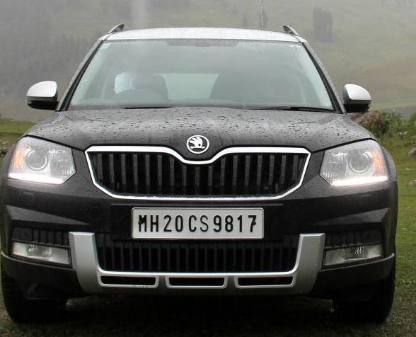
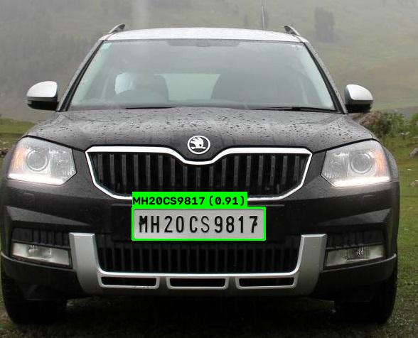
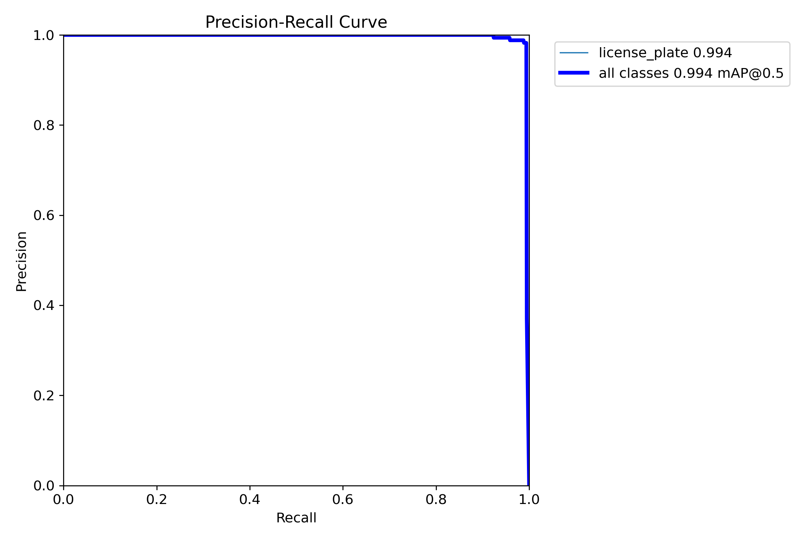

# Number Plate Recognition System

Detects licence plates with a fine-tuned **YOLOv8n** model (Ultralytics) and reads them with **EasyOCR**
(default, pure pip) or **Tesseract** (optional, detected at runtime). Works on images, folders, video files and webcam;
uses Apple MPS / CUDA when available, otherwise CPU.

| Input | Output |
|---|---|
|  |  |

## Quick start

```bash
git clone https://github.com/parvashah29/Number-Plate-Recognition-System.git
cd Number-Plate-Recognition-System
python3 -m venv venv && source venv/bin/activate      # Windows: venv\Scripts\activate
pip install -r requirements.txt

python main.py --source assets/sample_input.jpg        # image
python main.py --source path/to/video.mp4 --no-display # video (annotated copy in output_results/)
python main.py --source 0                              # webcam, press q to quit
```

The trained weights ship with the repo (`models/plate_best.pt`, ~6 MB). EasyOCR downloads its small English models
on first use. Tested on Python 3.12, macOS arm64 (clean venv install + test suite).

Useful flags: `--weights`, `--ocr {auto,easyocr,tesseract}`, `--device {auto,cpu,mps,cuda}`, `--conf`, `--stride`,
`--max-frames`, `--no-display` (also automatic fallback on headless OpenCV), `--debug`. Run `python main.py --help`.

Outputs (all git-ignored): annotated media in `output_results/`, unique plate crops in `detected_plates/`,
per-video logs in `plate_logs/`. In video mode the same plate (or a one-character OCR variation of it) is logged once.

Optional Tesseract: `brew install tesseract` / `apt install tesseract-ocr`, then `pip install pytesseract`
and `--ocr tesseract`. The code does not require it.

## How it works

- `license_plate_detection.py` - `LicensePlateDetector`: YOLO detection, crop, CLAHE/upscale preprocessing, OCR with
  several image variants, plate-text validation (4-10 alphanumerics with letters and digits; light repair of O/0, I/1
  confusions for Indian plate layouts such as `MH01AB1234`), de-duplication across video frames.
- `main.py` - CLI. `train.py` - fine-tune (`python train.py --data-root archive`). `evaluate_model.py` - metrics below.
- `plate_detection.py` - optional classical OpenCV contour detector (not used by the main pipeline).

## Dataset (not included)

The model was trained on a licence-plate detection dataset in YOLO format (1525 train / 169 val images, one class,
many frames from Indian road video). Download it yourself and arrange it as
`archive/images/{train,val}` and `archive/labels/{train,val}`, then run `python train.py`.

## Measured results

Detection, validation split (169 images, `python evaluate_model.py --limit 0`): precision 0.988, recall 0.988 at IoU 0.5.
Training log mAP50 at epoch 100: 0.993.

OCR: the dataset has boxes only, no plate text. I hand-read 29 crops from 30 evenly spaced validation images
(one crop unreadable even to me) and compared: **10/29 exact matches (34%), character accuracy 67%**.
Across all 169 validation detections the OCR returned a valid-looking plate string for 86% (read rate, not accuracy).
OCR is the weak part: blurry, small, dark or two-line plates are often misread (`MH`/`HH`, `0`/`O`, `6`/`8`).
Detection is solid; treat OCR text as a best guess. Throughput is roughly 1 s per plate on Apple MPS.



## Tests

```bash
pip install -r requirements-dev.txt
pytest
```

Logic tests always run; the pipeline smoke tests skip when weights are absent.

## Limitations

Plate text validation is generic (not country-specific beyond the Indian repair heuristic); single-line plates work best;
`--ocr tesseract` was not exercised on this machine (Tesseract not installed).
